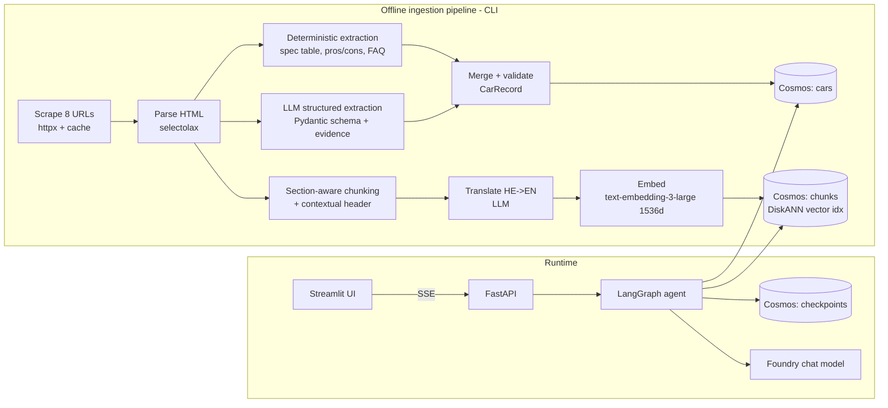
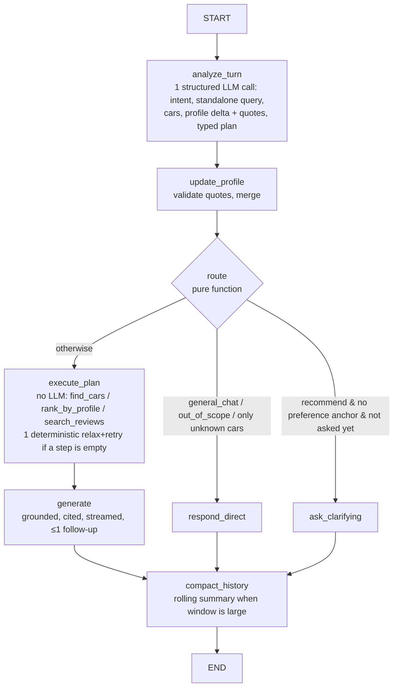

# Implementation Plan — Automotive Review Chatbot (POC)

Stack: **LangGraph** (orchestration) · **Azure Cosmos DB for NoSQL — local vNext emulator** (documents + vectors + checkpoints) · **FastAPI** (API) · **Streamlit** (UI) · **Microsoft Foundry** (chat LLM + embeddings). Everything runs locally except the Foundry model endpoint.

---

## 0. Research findings that drive the design

| Finding | Source | Design impact |
|---|---|---|
| auto.co.il pages are **static HTML**, Hebrew, and return 200 with a browser User-Agent. Simple fetchers get redirected to an ad tracker. | Probed `mg-s6` | Use `httpx` with a UA header and cache the raw HTML in `data/raw/`. No headless browser needed. |
| Each article has a **spec table** (`.table-item__title` / `.table-item__value`), for example price ₪168,888, WLTP 530 km, real range 430 km, 0-100 in 7.3s, DC 144 kW, pros and cons. | HTML inspection | Read **deterministic metadata** from the table. No LLM is needed for those fields. |
| Section headings (`<h2>`) are already written as questions ("How is the trunk?", "Is the driver's environment good?"), and each article ends with a **pros/cons/value** section and an **FAQ** section. | HTML inspection | **Section-aware chunking**: one chunk per H2 section, with a tagged `section_type`. FAQ Q&A pairs become their own chunks. |
| The vNext emulator supports **DiskANN vector indexes**, but **not full-text/BM25**. Range and composite indexes are accepted but not optimized. | MS Learn: emulator-linux + `cosmos_smoke.py` | Vector search runs in Cosmos. **BM25 runs in the app** (`rank_bm25`), and the two result lists are merged with **RRF in Python**. |
| **Verified on the emulator:** `WHERE` together with `ORDER BY VectorDistance` is applied *after* the approximate top-K (`TOP 5 … WHERE car_id=X` returned 0 rows, and `TOP 30` returned 2). Scoping with `partition_key=` and no `WHERE` is exact. Parameterized `@qv` works. | `filter_recall_probe.py` | **Filter-then-partition-fanout:** exact SQL on `cars` produces `car_ids`. Then run one vector query per car (`partition_key=car_id`) in parallel, merge the results, and apply chunk-level filters in Python. |
| **Verified on the pages:** body is `div.sections__items .text-wrapper`. Sections are h2/h3 or short bold `<p>`. FAQ (`details.spollers__item`) exists only on MG S6, Elantra N and Lynk & Co. **Kia EV9 has no spec table** (it is a long-term report). Kia and Elantra have 1 heading, so they need size-based splitting. | `probe_articles.py` | Selectors are documented in the `autochat-ingestion` skill. Every Kia field comes from the LLM, with evidence. |
| Cosmos full-text search has no Hebrew support (en/de/es/fr/it/pt only). | MS Learn: full-text-search | Not relevant on the emulator, but it supports storing an **English translation** per chunk. That lets BM25 and the LLM work in both languages, and lets us switch to native `ORDER BY RANK RRF(...)` on Azure later. |
| Vector policies are **immutable** after a container is created. | MS Learn: hybrid-search | Use a `scripts/reset_db.py` that drops and recreates containers. Fix the embedding dimensions up front. |
| `langchain-azure-cosmosdb` v1.x ships the vector store **and a LangGraph checkpointer**. | LangChain docs / Cosmos blog | Use its **checkpointer** for conversation state. Use the raw `azure-cosmos` SDK for retrieval, which gives full control over filtered queries. Fall back to `SqliteSaver` if the checkpointer fails on the emulator. |
| `langchain-azure-ai` → `AzureAIOpenAIApiChatModel` / `AzureAIOpenAIApiEmbeddingsModel` are the current Foundry classes (v2 SDK). | MS Learn: langchain-models | Use these classes with the endpoint and key from `.env`. |
| `text-embedding-3-large` has strong multilingual retrieval (MIRACL) and supports the `dimensions` parameter. | Foundry catalog / OpenAI | Embed Hebrew and English with **1536 dims** (good quality/size balance; within the DiskANN limit). |

---

## 1. Architecture



### Cosmos DB data model (database `autochat`)

| Container | Partition key | Contents | Indexing |
|---|---|---|---|
| `cars` | `/car_id` | One **CarRecord** per car: structured specs, LLM-derived attributes, aspect scores, summary, URL | Default |
| `chunks` | `/car_id` | Section chunks: `text_he`, `text_en`, `section_type`, `embedding`, plus **denormalized filter fields** (make, body_type, powertrain, price_ils, model_year) | Vector policy `/embedding` float32 cosine 1536, `vectorIndexes: diskANN`, exclude `/embedding/*` |
| `checkpoints` | (managed by checkpointer) | LangGraph thread state, including the inferred user profile | Default |

> Partitioning by `car_id` makes per-car questions single-partition. Cross-car queries fan out over only 8 partitions, which is fine for a POC.

### CarRecord schema (Pydantic). This is what metadata filtering runs on.

```text
car_id, url, title, make, model, trim, model_year, review_date, review_type (road_test|long_term)
body_type (hatchback|sedan|suv|crossover|7-seat-suv|...), segment
powertrain (ev|ice|hybrid|phev), drivetrain (fwd|rwd|awd), transmission (manual|auto|dct|single-speed)
price_ils, monthly_payment_ils
power_hp, torque_nm, accel_0_100_s, top_speed_kmh
battery_kwh, range_wltp_km, range_real_km, dc_charge_kw, consumption (kWh/100km or km/l)
seats, trunk_l, length_mm, wheelbase_mm
pros[], cons[], verdict_summary_he, verdict_summary_en
aspect_scores {performance, comfort, practicality, tech, value, efficiency, fun}: 1-5 + evidence quote
tags[] (family, enthusiast, city, off-road-light, luxury, budget)
extraction_meta {source: table|llm, confidence}
```

**Source precedence:** values from the spec table override LLM values. Every LLM-extracted field must cite an evidence quote. Fields with no evidence are set to `null`, never guessed.

---

## 2. LangGraph conversation design (as built: planner → code executor)



**Why planner → executor instead of a ReAct tool loop:** compound questions ("cheapest EV with 400 km range, and how is its ride?") need several retrieval operations, but a free tool loop adds 2–5 LLM round trips, makes evals non-deterministic and lets the model drift from the corpus. Here the planner writes a **typed plan** (≤4 `PlanStep`s) inside the one `analyze_turn` call, and plain Python runs it. The tools are LangChain `StructuredTool`s, so each step is an MLflow TOOL span. Replanning is a code rule: relax the empty step (budget +10%, drop soft filters, drop section focus) and retry once. It replaces the planned `grade_context` LLM call. LLM calls per turn: 2 (plan + answer), plus 1 occasional summary call.

**State** (`TypedDict`, checkpointed per `thread_id`): persistent `messages` (add_messages, never deleted), `summary`, `summarized_upto`, `user_profile` and `clarified`. Per turn (reset by `analyze_turn`): `language`, `intent`, `standalone_query`, `mentioned_car_ids`, `unknown_cars`, `profile_delta`, `profile_dropped`, `plan`, `plan_trace`, `exec_notes`, `candidate_car_ids`, `retrieved`, `answer` and `sources`. Dependencies (retriever, car records, LLMs) are injected as the LangGraph runtime `context` (`AgentContext`), so tests use fakes.

**Plan tools:**
- `find_cars(filters, sort_by, descending, limit)`: exact Cosmos filter + sort, for hard constraints and superlatives.
- `rank_by_profile(car_ids, limit)`: profile hard constraints (budget ×1.1, powertrain, body, rejected) and then `Σ priority_weight × aspect_score + use-case tag bonus + liked bonus`.
- `search_reviews(query, car_ids, section_types)`: hybrid retrieval, with car cards always included.

Each step's cars feed the next step (`use_previous`). Every non-chat plan ends with `search_reviews`, so answers always have citable excerpts.

**Gradual preference inference with evidence.** `profile_delta` must carry a verbatim quote from the user's last message for each field, the same "evidence or null" rule as ingestion. `validate_delta` drops fields without a matching quote. Fields the small model over-infers (powertrain, body, liked/rejected cars) also need an explicit cue word. `replace_lists` needs a change-of-mind cue ("actually", "בעצם"). The profile persists per thread. Each recommendation ends with at most one question about the most valuable missing slot (budget > use > passengers > powertrain). `ask_clarifying` fires at most once per thread, and only when the profile has no anchor at all.

**Long conversations: `compact_history`** runs after every answer and is a no-op unless the unsummarized window exceeds 16 messages or ~6k tokens (`count_tokens_approximately`). It then folds everything except the last 6 messages into `summary` (fast model, car-shopping-focused prompt). The transcript is **not** deleted, unlike LangChain's `SummarizationMiddleware`, which removes all messages and targets coding agents. The UI and checkpoints keep full history. Only the prompts switch to summary + recent window.

**Grounding rules (system prompt):** answer only from the numbered excerpts (car cards carry the structured specs). Cite as `[n]`; `sources` contains only the cited excerpts. If something isn't covered, say so. Unknown cars and off-topic requests go to `respond_direct`, with no retrieval and no car facts. Answer in the user's language, detected deterministically from the message script. Planner notes are internal and are never mentioned.

---

## 3. Hybrid retrieval (emulator-compatible)

1. **Embed** the standalone query (1536 dims).
2. **Resolve filters to cars**: run exact parameterized SQL on `cars` (`WHERE c.price_ils <= @max AND ARRAY_CONTAINS(@pt, c.powertrain)`) to get `car_ids`. If there are no filters, use all 8 cars.
3. **Vector search fanout** with one query per car, run in parallel. **No `WHERE` clause** (see §0):
   ```sql
   SELECT TOP 8 c.id, c.car_id, c.section_type, c.text_he, c.text_en, c.url,
          VectorDistance(c.embedding, @qv) AS score
   FROM c ORDER BY VectorDistance(c.embedding, @qv)
   ```
   Pass `partition_key=car_id`. Merge the results by score, then apply `section_type` and other chunk filters in Python.
4. **BM25 in the app** (`rank_bm25`) over `text_en + text_he`, held in memory and loaded from Cosmos at startup. The corpus has only ~150–250 chunks. Restrict it to the same `car_ids`, plus light Hebrew prefix normalization (strip ו/ה/ב/ל/מ/ש/כ on tokens longer than 3 characters).
5. **RRF fusion** in Python: `score = Σ 1/(60 + rank)`, with weights `[vector 2, bm25 1]`.
6. **Diversity:** cap chunks per car for comparisons. Always include the `verdict` section chunk for recommended cars.
7. **Swap point:** a `Retriever` interface with an `AzureCosmosHybridRetriever` implementation that uses native `ORDER BY RANK RRF(VectorDistance(...), FullTextScore(c.text_en, ...))`. This is documented but not required for the POC.

---

## 4. Project structure

```text
AI_Engnieer/
├─ docker-compose.yml          # cosmos vnext emulator (8081, 1234 data explorer, 8080 health)
├─ .env.example                # FOUNDRY_ENDPOINT, FOUNDRY_API_KEY, CHAT_DEPLOYMENT, EXTRACT_DEPLOYMENT, EMBED_DEPLOYMENT, COSMOS_*
├─ pyproject.toml              # uv-managed
├─ README.md                   # approach, architecture, trade-offs, run steps, example transcript
├─ data/
│  ├─ urls.txt
│  ├─ raw/                     # cached HTML (reproducible, no re-scrape)
│  └─ processed/               # cars.json, chunks.jsonl (committed -> reviewers can skip scraping)
├─ src/autochat/
│  ├─ config.py                # pydantic-settings
│  ├─ llm.py                   # Foundry chat + embeddings factories
│  ├─ db/cosmos.py             # singleton async client, container bootstrap (vector policy)
│  ├─ ingestion/
│  │  ├─ scrape.py  parse.py  extract.py  chunk.py  translate.py  embed.py  load.py
│  │  ├─ schemas.py            # CarRecord, Chunk, ExtractionResult
│  │  └─ pipeline.py           # `python -m autochat.ingestion.pipeline`
│  ├─ retrieval/
│  │  ├─ vector.py  bm25.py  hybrid.py  filters.py
│  ├─ agent/
│  │  ├─ state.py  prompts.py  nodes.py  graph.py  profile.py
│  ├─ api/main.py              # FastAPI
│  └─ ui/app.py                # Streamlit
├─ scripts/dev.ps1             # task runner: setup|emulator|smoke|probe|ingest|reset-db|api|ui|chat|test|eval|lint
├─ .github/                    # copilot-instructions, instructions/*.md, skills/* (each with scripts/)
├─ eval/
│  └─ golden.jsonl             # 22 cases incl. hallucination traps (runner: .github/skills/autochat-eval/scripts/run_eval.py)
└─ tests/                      # parser + filter + RRF unit tests
```

---

## 5. Step-by-step execution (~5 h)

### Phase 1 — Setup (20 min)
1. ✅ `pyproject.toml` + `.venv` (Python 3.13). `uv` is not on PATH, so use `python -m uv pip install --python .venv\Scripts\python.exe -e ".[dev]"` (or `scripts/dev.ps1 setup`). selectolax uses the **lexbor** backend.
2. ✅ `docker-compose.yml` (vnext-latest, HTTP, named volume `autochat-cosmos-data:/data`; a Windows bind mount is ~13× slower per write). `scripts/dev.ps1 emulator` starts it and waits for `:8080/ready`.
3. ✅ `.env.example`. ⏳ `config.py`. Run `scripts/dev.ps1 smoke`: the Cosmos half passes (7/7). The Foundry half needs `.env`.

### Phase 2 — Ingestion pipeline (90 min)
4. **Scrape:** fetch the 8 URLs with UA header, retry, and polite delay. Save to `data/raw/{slug}.html`. Skip the download if the file is cached.
5. **Parse:** read `og:title`, `og:description`, the H1, the publish date, and the main article container. Split the body into `sections[]` by H2 (heading + paragraphs). Drop boilerplate such as "join our WhatsApp", "latest articles", and "competing brands". Parse the spec table, pros/cons, and FAQ into structured data.
6. **Deterministic normalization:** turn `₪168,888` into `168888` and parse `7.3`, `530`, and so on. Map Hebrew labels to canonical keys (`מחיר` → `price_ils`, `טווח נסיעה בפועל` → `range_real_km`, ...). The label map will grow as ICE and EV pages differ.
7. **LLM extraction** (extraction model, `with_structured_output(CarRecordLLM)`, temperature 0). Input: full article text plus the table values that are already known. Output: the remaining fields + aspect scores with evidence quotes + EN/HE verdict summaries + tags. Validate with Pydantic and log any field without evidence.
8. **Chunking:** one chunk per section (merge if under 120 tokens, split if over 600 with overlap). Add a contextual header to every chunk: `"{make} {model} {year} | {section heading} | {body_type}, {powertrain}, ₪{price}"`. FAQ pairs become separate chunks. Also create one synthetic **"car card"** chunk per car from the CarRecord, which helps with spec questions.
9. **Translate** each chunk HE→EN. Batch the calls and cache results in `processed/`.
10. **Embed** `header + text_he + text_en` (1536 dims) in batches with retry. Normalize the vectors.
11. **Load:** create the containers (vector policy + DiskANN) and upsert `cars` and `chunks`. Write `processed/*.json` so the load is reproducible.
12. **Unit tests:** parser on 2 cached pages, price normalization, label mapping.

### Phase 3 — Retrieval (40 min)
13. `filters.py`: build parameterized Cosmos SQL from the `filters` model (no string concatenation of user input).
14. `vector.py` (per-car partition fanout, no `WHERE`), `bm25.py` (in-memory index, loaded at startup), `hybrid.py` (RRF + diversity).
15. Quick retrieval check script with ~10 queries; eyeball the top-5 results. Examples: "trunk size of Citroen C3", "which EV charges fastest", "RS3 sound".

### Phase 4 — LangGraph agent (75 min) — DONE
16. `state.py` (AgentState + AgentContext), `profile.py` (UserProfile, evidence-validated deltas, merge, next-best question), `schemas.py` (TurnAnalysis, PlanStep, Source).
17. `tools.py` (StructuredTools + code executor + deterministic relax), `nodes.py` (`analyze_turn`, `update_profile`, `execute_plan`, `generate`, `respond_direct`, `ask_clarifying`, `compact_history`).
18. `graph.py` (pure `route`, compiled with `CosmosDBSaver`, `InMemorySaver` fallback), `runtime.py` (`get_runtime`, `run_turn`: MLflow `chat_turn` span, token streaming from answer nodes only, `recursion_limit=25`).
19. Prompts in `prompts.py`. Verified: 59 offline tests, golden eval 22/22 (local scorer), traces show TOOL + RETRIEVER spans. Typical turn takes ~15–20 s (planner 3–9 s, retrieval ~1.5 s, streamed answer 7–12 s).

### Phase 5 — FastAPI (25 min) — DONE
20. `src/autochat/api/` = `schemas.py` (Pydantic request/response models) + `main.py` (`create_app(runtime_factory, tracing, health_checks)`; module-level `app`). Endpoints:
    - `POST /chat` `{thread_id, message, user?}` → SSE `token {"t"}` … `sources [...]` → `profile {...}` → `done {"trace_id"}` (or `error {"detail"}`, generic text only).
    - `POST /chat/invoke` → same payload as JSON (`answer, sources, profile, intent, language, steps, trace_id`). Used by eval.
    - `POST /feedback` `{trace_id, value, comment?}` → MLflow human assessment, 204 (404 unknown trace, 503 tracing off).
    - `GET /threads/{id}/profile` (default profile for new threads), `GET /threads/{id}/history` (`{role, content}` + summary).
    - `GET /cars` (`CarSummary` list), `GET /cars/{car_id}` (full record minus `adapter`/`source_sha`/`dropped`/`_*`), 404 if unknown.
    - `GET /health` → Cosmos query + Foundry embedding ping (cached 60 s, 10 s timeout), checkpointer type, car count, tracing; 503 when degraded. `/admin/ingest` skipped (use `dev.ps1 ingest`).
21. Lifespan enters `get_runtime()` once (Cosmos client, BM25, LLM clients, `CosmosDBSaver`, compiled graph). CORS for `localhost:8501`. Each turn runs in its own task, so a client disconnect never cancels a half-written checkpoint. One turn per `thread_id` at a time (409). `thread_id` must match `^[A-Za-z0-9._-]{1,128}$` (CosmosDBSaver rejects its key separator).
22. Verified: 18 API tests (fake runtime, `TestClient`), 77 total. Live: `/health` ok, `chat_cli --api` SSE transcript (`eval/transcripts/api_family_en.txt`), `run_eval --api --only fact,abstain` 10/10 (MLflow `golden_pass/mean` 1.0), feedback 204 on a real trace.
23. **Latency finding:** the emulator's `/data` was a Windows bind mount, so every Cosmos write took ~1.5 s versus ~0.1 s on a named volume. LangGraph checkpointing does ~37 writes per turn, which added ~25–30 s. `docker-compose.yml` now uses the named volume `autochat-cosmos-data`. Checkpoint I/O is now ~1 s per turn, and fact turns dropped from ~55 s to ~8–14 s. `get_runtime()` also pre-imports lazily-loaded `openai`/`mlflow` modules, which stalled the event loop up to 9 s on the first turn.

### Phase 6 — Streamlit UI (30 min) — DONE
24. `src/autochat/ui/`: `client.py` (httpx + SSE → `ChatStream`), `state.py` (session, typed `Message`, `?thread=` resume), `components.py` (formatters + renderers), `app.py` (page flow). Each layer can be replaced on its own; for example, the client can be reused by a CLI or another frontend.
25. Chat pane: spinner until the first token, then `st.write_stream`. `[n]` citations link to the review section. Under each answer: "Sources" and "How I answered" (planner steps) expanders, plus 👍/👎 feedback sent to MLflow. Example prompts (EN + HE) on an empty chat.
26. **Sidebar:** "New conversation", inferred profile as chips (budget, passengers, use, powertrain, priorities, home charging, liked/rejected), and the reviewed-cars catalog with links.
27. Hebrew/mixed text: per-block `unicode-bidi: plaintext` CSS, so each paragraph, list item and table cell picks its own direction, including while streaming. No raw HTML from the model.
28. Verified: 11 UI tests (client against the API app on fakes, formatters, `AppTest` turn/resume/API-down), 88 total. Live: headless `AppTest` against the real API (EN recommendation 21 s, HE question 11 s), and `dev.ps1 ui` serving on :8501.

### Phase 6b — Docker packaging — DONE
- One `Dockerfile` (python:3.13-slim, deps via uv, non-root, code + `data/` baked in, `.env` never copied) serves four roles. `docker-compose.yml` runs `cosmos` (healthcheck on `:8080/ready`) → `init` (one-shot `ingestion.pipeline`; extractions, translations and embeddings are cached in `data/processed/`, so no LLM calls) → `api` (healthy once the lifespan finished) → `ui`, plus `mlflow` (tracking server, sqlite + artifacts on the `autochat-mlflow-data` volume, `--allowed-hosts` includes `mlflow:5000`, `--workers=1`).
- Service URLs are overridden in `environment:` (`COSMOS_ENDPOINT`, `API_BASE_URL`, `MLFLOW_TRACKING_URI`); everything else comes from `.env` via `env_file`.
- Verified: cold `up` ~3 min (MLflow start dominates), chat turn 11 s, trace stored in the MLflow server, 88 tests pass inside the image. Local venv development is unchanged; the container and local stacks share ports, so run one at a time.

### Phase 7 — Evaluation & submission (40 min) — DONE
Status: golden set at 26 cases; `--judge` run (2026-10-21, gpt-5.5 judge): golden 26/26, `grounded_or_abstains` 1.0, `relevance_to_query` 1.0, `same_language` 1.0, `retrieval_groundedness` 0.95. Judge fixes: bounded `genai.evaluate` concurrency (the defaults timed out every judge), chat model as default judge, Guidelines judges on the answer text only, relevance/groundedness skipped on abstain cases, a top-level `plan_evidence` RETRIEVER span (catalog selections + final context). Real bugs the judges found: uncited headline prices, English "not stated" in Hebrew tables (prompt fixed). README has the eval/MLflow section and EN + HE transcripts ([eval/transcripts/](eval/transcripts/)).
29. `eval/golden.jsonl` with ~20 cases:
    - Factual: "What is the MG S6 price?", "0-100 of the Elantra N?"
    - Comparison: "GV80 vs EV9 for a family of 6"
    - Preference flow: a 3-turn dialog
    - Traps: "Tesla Model 3 range?" (must say the car isn't covered), "price of the Aion HT in 2030"
    - Hebrew queries
30. `run_eval.py` runs each case through `run_turn` (one MLflow trace per turn), then logs one MLflow run (experiment `autochat-eval`). It scores with the deterministic `golden` scorer (retrieval hit, keyword/number checks, abstention, profile) and, with `--judge`, Foundry-backed MLflow judges: RelevanceToQuery, RetrievalGroundedness, language and citation Guidelines. Runs are compared in the MLflow UI (`dev.ps1 mlflow`).
31. README: approach, architecture diagrams, design decisions and trade-offs, run instructions (`scripts/dev.ps1 setup` → `emulator` → `ingest` → `api` → `ui`), and **2 example transcripts** (EN + HE) captured from real runs.

### Phase 8 — Any number of cars (N-independent agent) — 8.0 / 8a / 8b DONE, 8c–8e NEXT
Problem (from review): the agent assumes ~8 cars. The full catalog is pasted into the planner prompt (`prompts.catalog_block`) and the car names into the answer/direct/clarify prompts (`catalog_names`); `ctx.cars` loads every car at startup and feeds name validation, `rank_by_profile`, `/cars` and the UI sidebar; unfiltered `search_reviews` fans out one vector query per car; `ChunkStore` loads every chunk into memory for BM25.

Principle: **prompt size and per-turn work must not grow with N. The LLM gets the schema and tools, never the data.**
Decisions (agreed): data stays the real 8 cars (no synthetic cars, in the DB or as benchmarks); no Spark; no MCP server; no Azure-only retriever; everything runs locally (venv first, then Docker).

- **8.0 Emulator probe (verify before building):** `ORDER BY <numeric> + TOP` cross-partition and how cars missing the field are handled; `COUNT` / `MIN` / `MAX` / `DISTINCT VALUE` cross-partition; `ARRAY_CONTAINS` on a string array; a vector query without `partition_key` (global top-K) and its recall vs. the per-partition fan-out. Results go into the cosmos-emulator skill. A fallback is chosen for anything unsupported.
- **8a. `CarCatalog` interface replaces `AgentContext.cars`:** `resolve(mentions)`, `find(filters, sort_by, limit)` (SQL pushdown, capped), `get(ids)` (point reads), `scope()` (count, enum vocabularies, price range; cached with a TTL), `page(q, offset, limit)`. Implementations: `CosmosCarCatalog` and `InMemoryCarCatalog` (tests). Prompts get a fixed-size scope line ("road tests of {count} cars, prices ₪x–₪y, powertrains …") instead of the car list.
- **8b. Car names resolved in code, not by the model:**
  - At load time, `name_keys` (normalized make, model, make+model, Hebrew names, aliases; Hebrew prefix and punctuation stripped; short or numeric-only model keys dropped, such as "01") is written on each `cars` doc. It is deterministic, so it needs a re-load but no LLM calls.
  - The planner returns `car_mentions` (verbatim names) and `focus_refs` (indices into a small `focus_cars` list in state, holding the cars shown in the last answer, at most 6). The planner prompt lists only that focus list.
  - Resolver steps: (1) exact `name_keys` match (one query); (2) if a known make is in the mention, a fuzzy match (`difflib`) over that make's cars only; (3) otherwise unknown.
  - Rules: never map an unknown model to a same-brand car ("Audi Q5" is unknown, not the RS3). Several close matches lead to one disambiguation question. Unknown cars get a few bounded suggestions (same make or segment) for `respond_direct`.
  - Plan steps reference cars by mention or focus index; the executor maps them to ids. This should also fix "compare the top two".
- **8c. Retrieval that does not scan N:**
  - `find_cars`: the filter, `ORDER BY` and `TOP` run in Cosmos, plus a `COUNT` for "x cars matched". The candidate cap is `MAX_CANDIDATES`.
  - `rank_by_profile`: the profile's hard constraints become SQL. If more than the cap still match, preselect by a global vector search over verdict/car-card chunks with the user's needs, then do the deterministic scoring on at most the cap.
  - `search_reviews`: with up to `FANOUT_MAX` (about 10) target cars, keep the exact per-partition fan-out. Otherwise run a global vector top-K (no `WHERE`) post-filtered to the targets, then group by car with the per-car cap.
  - Keyword search: the in-memory `rank_bm25` is replaced by a local **SQLite FTS5** index (stdlib, on disk, `bm25()` ranking, `car_id` filter). It is built in the ingestion `load` stage from `chunks.jsonl` (same Hebrew tokenizer), kept at `data/index/keyword.sqlite` locally and on a named volume shared by `init` and `api` in Docker. It sits behind a `KeywordIndex` interface, with the in-memory version kept for tests.
  - Chunk text comes back in the vector query or from point reads, so there is no full chunk load at startup.
  - API: `/cars?q=&offset=&limit=` is paginated and `/health` reports the count. UI sidebar: the count, a search box and the first page instead of every car.
- **8d. Ingestion at scale, without Spark:** the scrape, extract, translate and embed concurrency and batch sizes become settings; stages are already resumable and content-hash cached. Documented as the scale path, with no new data.
- **8e. Tests and eval (only the 8 real cars):**
  - N-independence is checked by structure, not volume: no system prompt contains catalog content, and prompt size does not depend on the catalog.
  - Resolver tests: Hebrew and English names, aliases, typos, "Lynk & Co" vs "Link and Co", "Audi Q5", "Tesla", ambiguity.
  - Retrieval mode tests: fan-out vs. global, keyword index parity with the old BM25 on the 8-car corpus.
  - Golden eval stays 22/22, plus new cases: "the second one", "Audi Q5" (same make, unknown model) and a typo name.
  - Done means `lint` + `test` + `eval` pass locally, then the same in Docker.

**Status (8.0 + 8a + 8b done):** `names.py` (normalization, `name_keys`), `retrieval/catalog.py` (`CarCatalog`, Cosmos + in-memory, `MAX_CANDIDATES=50`, cached `scope()`), `retrieval/resolver.py` (exact → same-make fuzzy → unknown with suggestions; ambiguity → one question), `focus_car_ids` in state (`#n` refs), `resolve_plan` (refs → ids, make canonicalization, degenerate-query drop), `rank_by_profile` pushes profile filters into `catalog.find`, paged `/cars?q=&offset=&limit=` with `X-Total-Count`. Already pulled forward from 8c: `find_cars` SQL pushdown and paged `/cars`. Checks: 118 tests + lint pass; golden eval 25/26 (the one miss, trap-future-price, was an abstain-pattern gap in the scorer, now fixed; 4 new cases: ordinal ref, typo name, Hebrew price, Audi Q5 trap); Docker stack verified (`/health` ok, paging, Hebrew `q`, 3-turn chat with "the second one" and the Audi Q5 trap). Remaining: SQLite FTS5 keyword index, global vector top-K above `FANOUT_MAX`, no full chunk load at startup, UI sidebar search/paging (8c); ingestion concurrency settings (8d); keyword-index parity tests (8e).

Order: 8.0 → 8a + 8b → 8c → 8d → 8e (tests are written alongside each step). Each step passes local checks first (see Test order in copilot-instructions), then Docker.

---

## 6. Key trade-offs to explain in the submission

- **Emulator vs Azure Cosmos:** fully local, at the cost of native BM25/hybrid. This is mitigated with app-side BM25 + RRF behind a `Retriever` interface, so moving to Azure is one config switch.
- **Structured + unstructured retrieval:** specs live in `cars` and are queried exactly with SQL, which avoids LLM arithmetic on prices. Opinions and experience come from `chunks` via semantic search. This is how the bot answers both "cheapest EV with 400+ km real range" and "is the ride comfortable".
- **Deterministic before LLM:** table values are trusted over LLM extraction. LLM fields need evidence. This reduces hallucinated metadata.
- **Where AI is (and isn't) used in ingestion:** all article data is text in the DOM. The pages contain 27–43 photos each, with no spec images or PDFs (verified), so **no OCR**. Raw HTML is not sent to an LLM either (cost, non-determinism, invented numbers). The LLM is used only to structure clean text into `CarExtraction` with evidence quotes, plus HE→EN translation and embeddings. Adding URLs: a site adapter, a `trafilatura` generic fallback (×1.21 body coverage, but it loses div-based spec tables, so those fields come from the LLM with evidence), and an incremental manifest. OCR (Azure Document Intelligence `prebuilt-layout`, which supports Hebrew) is the extension point only for future PDF brochures or image-only spec sheets.
- **Observability:** MLflow traces every turn (LangGraph autolog + RETRIEVER span + session = thread). UI thumbs become human feedback on the trace. The same traces are scored by `mlflow.genai.evaluate`, all locally.
- **Section-aware chunks + contextual headers:** the articles are already split by topic, and the header keeps every chunk self-identifying ("which car is this about?").
- **One analysis call per turn** (intent + filters + preferences + rewrite) keeps latency and cost low compared with several separate classifiers.
- **Small corpus:** no reranker model is needed. An LLM `grade_context` with one corrective retry is enough.
- **Out of scope for this POC:** auth, multi-user isolation beyond thread_id, scheduled re-ingestion, prompt-injection hardening of scraped text (noted as future work).

## 7. Risks & mitigations

| Risk | Mitigation |
|---|---|
| Site layout or anti-bot changes | Raw HTML cached and `processed/` committed. The pipeline can run from cache only. |
| Spec table labels differ for ICE vs EV cars | Extensible label map. Unknown labels are logged and passed to the LLM extractor. |
| Emulator quirks | Verified: param binding works, the checkpointer works, and `WHERE` on vector queries loses rows (handled with the partition fanout). Transient `E57014` errors on container create are handled with a retry. |
| Hebrew tokenization for BM25 | Prefix normalization + English translation field. Vector search does most of the work. |
| Vector policy immutability | `scripts/dev.ps1 reset-db` + fixed 1536 dims in config. |

---

## 8. Inputs needed before coding

- Foundry **endpoint**, **API key** (or Entra ID), and deployment names for: chat model (generation), optional smaller model (extraction/analysis), embedding model (`text-embedding-3-large` assumed).
- Docker Desktop running (for the emulator).
