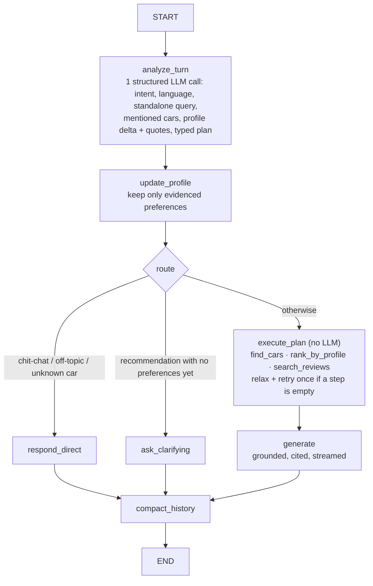
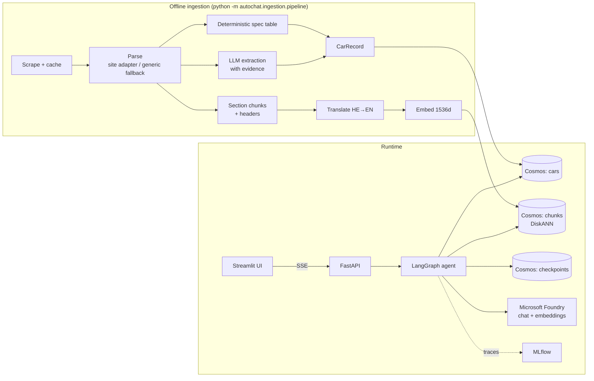

# autochat: a grounded chatbot over Hebrew car road tests

A proof-of-concept chatbot that helps users understand and compare the 8 cars reviewed in the auto.co.il road-test articles. It answers in Hebrew or English, gradually learns what the user is looking for, and answers only from the reviews, citing them as `[n]`.

## Run it

Requirements: Docker (with Compose) and a Microsoft Foundry endpoint with a chat model, a smaller "fast" chat model and `text-embedding-3-large`. Nothing else is installed on the host.

```powershell
copy .env.example .env      # then fill in FOUNDRY_ENDPOINT, FOUNDRY_API_KEY and the *_DEPLOYMENT names
docker compose up -d --build
```

| URL | What |
|---|---|
| http://localhost:8501 | Chat UI (Streamlit) |
| http://localhost:8000/docs | API (FastAPI) |
| http://localhost:5000 | MLflow: a trace per chat turn, user feedback, evaluation runs |
| http://localhost:1234 | Cosmos DB Data Explorer |

The first start builds the image (a few minutes) and waits for the services in order: the Cosmos emulator, a one-shot `init` job that loads the 8 cars and 110 chunks from the committed `data/processed/` cache (no LLM calls), then the API, then the UI. Stop with `docker compose down`; add `-v` to also delete the database and MLflow volumes. On Windows, `scripts/dev.ps1 up|down|logs` are shortcuts.

Ports are published on `127.0.0.1` only, so the services are not exposed to the network. If a page hangs on `localhost` but works on `http://127.0.0.1:8501`, the browser is taking the IPv6 route through the WSL relay (`wslrelay.exe`); use the `127.0.0.1` address.

Other commands run inside the same image:

```powershell
docker compose run --rm api python -m pytest -q                          # unit tests
docker compose run --rm api python .github/skills/autochat-eval/scripts/run_eval.py --judge   # golden eval -> MLflow :5000
docker compose run --rm init python -m autochat.ingestion.pipeline --force   # re-run the LLM extraction
```

For local Python development (`.venv`, `scripts/dev.ps1 setup|emulator|api|ui`), see [PLAN.md](PLAN.md).

## Approach

The design rests on one observation: the articles contain two kinds of knowledge, and each needs a different kind of retrieval.

| Knowledge | Example question | How it is stored and queried |
|---|---|---|
| **Facts** (price, range, 0-100, seats, trunk) | "Cheapest EV with 400+ km real range?" | One structured `CarRecord` per car, queried with **exact SQL** (filter and sort). The LLM never does arithmetic on prices. |
| **Opinions and experience** (ride, cabin, pros/cons, verdict) | "Is the GV80 comfortable for a family?" | Section-level text chunks, queried with **hybrid search** (vectors + BM25). |

### 1. Ingestion (offline, run once)

1. **Scrape**: fetch the 8 pages with `httpx` and cache the raw HTML in `data/raw/`, so the pipeline is reproducible without the site.
2. **Parse**: a `selectolax` site adapter reads the article body, H2 sections, spec table, pros/cons and FAQ. A `trafilatura` generic adapter is the fallback for other sites. All of the data is text in the DOM (verified), so no OCR is needed and no raw HTML goes to an LLM.
3. **Extract**:
   - Spec-table values are parsed **deterministically** (`₪168,888` → `168888`; Hebrew labels mapped to canonical keys).
   - An LLM fills only the remaining fields: body type, aspect scores, tags and verdict summaries.
   - **Every LLM field must quote evidence from the article or be `null`.**
   - Table values always override LLM values. The Kia EV9 is a long-term report with no spec table, so all of its fields come from the LLM, with evidence.
4. **Chunk**: one chunk per article section (the headings are already topical questions such as "How is the trunk?"). Each FAQ pair gets its own chunk, plus one synthetic "car card" per car. Every chunk carries a contextual header (`make model year | section | body, powertrain, price`), so it identifies its car on its own. The result is 110 chunks.
5. **Translate and embed**: each chunk is stored as `text_he` plus an LLM-made `text_en`, and both are embedded with `text-embedding-3-large` (1536 dims). Cross-lingual queries and English BM25 both work.
6. **Load**: the `cars` and `chunks` containers go into Cosmos DB. The chunks container has a DiskANN vector index.

### 2. Retrieval (emulator-compatible hybrid search)

The local Cosmos DB emulator supports vector search but **not** full-text/BM25 search. Hybrid search is therefore assembled in the app:

1. **Filter → cars**: metadata filters (budget, powertrain, body type, ...) run as exact parameterized SQL on `cars` and return a set of `car_ids`.
2. **Vector search**: one query per car, scoped with `partition_key=car_id` and run in parallel. Putting a `WHERE` on a vector query is wrong on the emulator: the filter is applied *after* the approximate top-K, and it returned 0 rows in testing.
3. **BM25**: `rank_bm25` runs in memory over the Hebrew and English text, with light Hebrew prefix normalization.
4. **Fusion**: weighted reciprocal rank fusion (vector ×2, BM25 ×1, k = 60), plus a per-car cap for diversity in comparisons.

Everything sits behind a `Retriever` interface. On Azure Cosmos DB, native `ORDER BY RANK RRF(VectorDistance, FullTextScore)` can replace the in-app fusion.

### 3. Conversation: a LangGraph planner → executor

Each user turn makes **two LLM calls**: one to plan and one to answer. The planner writes a typed plan, and plain Python executes it. A free ReAct tool loop was rejected because it would add LLM round trips, make evaluation non-deterministic and let the model drift from the corpus.



- **Plan tools:**
  - `find_cars`: exact filters and superlatives over `CarRecord`s.
  - `rank_by_profile`: scores cars against the user's priorities using the evidence-backed aspect scores.
  - `search_reviews`: hybrid retrieval.

  Compound questions ("cheapest EV with 400 km range, and how is its ride?") become a short chain of these steps.
- **Gradual preference inference:** the planner proposes profile updates (budget, passengers, use, powertrain, priorities, liked/rejected cars). Each update must include a **verbatim quote** from the user's message, or it is dropped, which is the same "evidence or null" rule used in ingestion. The profile persists per conversation. Each recommendation ends with at most one question about the most useful missing detail.
- **Grounding:**
  - The answer prompt contains only the retrieved excerpts and car cards, numbered for `[n]` citations that link to the review section.
  - If a car or fact is not in the corpus, the bot says so. Unknown cars and off-topic requests never reach retrieval.
  - The bot replies in the user's language, detected from the message script.
- **Memory:** LangGraph checkpoints are stored in Cosmos DB, one thread per conversation. Long chats are compacted into a rolling summary for the prompt, while the full transcript is kept.

## Architecture



| Layer | Technology | Code |
|---|---|---|
| Models | Microsoft Foundry: a chat model, a smaller "fast" model (planning, extraction, translation), `text-embedding-3-large` | [src/autochat/llm.py](src/autochat/llm.py) |
| Storage | Azure Cosmos DB for NoSQL **vNext emulator** (Docker): documents, vectors and LangGraph checkpoints, all partitioned by `car_id` | [src/autochat/db/](src/autochat/db/) |
| Ingestion | `httpx`, `selectolax`, `trafilatura`, Pydantic structured output | [src/autochat/ingestion/](src/autochat/ingestion/) |
| Retrieval | Cosmos `VectorDistance` + `rank_bm25` + RRF; `CarCatalog` (SQL filter/sort/`TOP`, paging, cached scope) and a code-side car-name resolver | [src/autochat/retrieval/](src/autochat/retrieval/), [src/autochat/names.py](src/autochat/names.py) |
| Agent | LangGraph state graph, `StructuredTool` plan steps, Cosmos checkpointer | [src/autochat/agent/](src/autochat/agent/) |
| API | FastAPI: `/chat` (SSE stream of tokens, sources, profile), `/chat/invoke`, `/feedback`, `/threads/{id}/…`, `/cars?q=&offset=&limit=` (paged), `/health` | [src/autochat/api/](src/autochat/api/) |
| UI | Streamlit: streamed answers with citation links, Sources and "How I answered" expanders, 👍/👎 feedback, inferred-profile sidebar, per-paragraph bidi rendering for Hebrew | [src/autochat/ui/](src/autochat/ui/) |
| Observability and eval | MLflow 3 (local): one trace per turn (session = thread), user feedback on traces, golden-set evaluation with a deterministic scorer and optional Foundry LLM judges | [src/autochat/observability.py](src/autochat/observability.py), [eval/golden.jsonl](eval/golden.jsonl) |

Everything runs locally, in five containers (`cosmos`, `init`, `mlflow`, `api`, `ui`) built from one Dockerfile, except the Foundry model endpoints. Inside the Compose network the services reach each other by name (`COSMOS_ENDPOINT`, `API_BASE_URL` and `MLFLOW_TRACKING_URI` are overridden in [docker-compose.yml](docker-compose.yml)); secrets come only from `.env`, which is never copied into the image.

## Evaluation and observability

**Tracing.** Every chat turn is one MLflow trace (session = conversation thread): the planner call, each tool step, the hybrid searches and the answer call. A top-level `plan_evidence` retriever span holds exactly what the answer model saw: the catalog query results (for "cheapest" or "quickest") and the numbered excerpts. 👍/👎 in the UI is stored as human feedback on that trace. Open http://localhost:5000, experiment `autochat`.

**Golden set.** [eval/golden.jsonl](eval/golden.jsonl) has 26 cases, with expected values taken from the real spec tables:

| Type | Cases | What it checks |
|---|---|---|
| fact | 8 | Prices, 0-100, DC charging, fuel use, real range, in Hebrew and English, including a misspelled name ("Genesys") and a bare make ("כמה עולה הסיטרואן?") |
| opinion | 3 | Pros/cons, ride, the Kia EV9 long-term report |
| filter | 4 | "Cheapest EV", "quickest", "EVs under ₪175k", "petrol under ₪230k" (exact SQL, not LLM arithmetic) |
| compare | 2 | Two-car comparisons, one in Hebrew |
| multi_turn | 4 | Preference inference over 3 turns, "is it comfortable?", "the second one" |
| abstain | 5 | Tesla, BMW X5, Audi Q5 (same brand as a reviewed car), a 2030 price, a pizza poem |

**Scoring.** `scripts/dev.ps1 eval` runs every case through the same `run_turn` the API uses and logs one MLflow run to the `autochat-eval` experiment. A deterministic `golden` scorer checks cited cars, expected numbers and words, abstention and the inferred profile. With `--judge`, Foundry-backed MLflow LLM judges are added (the chat deployment by default; `MLFLOW_JUDGE_DEPLOYMENT` overrides):

| Judge | Measures | Scope |
|---|---|---|
| `relevance_to_query` | The answer addresses the question | Answering cases (a correct refusal is not "irrelevant") |
| `retrieval_groundedness` | Every claim is supported by the `plan_evidence` documents | Turns that retrieved |
| `same_language` | Reply language = user language (car names, numbers and ₪ excluded) | All |
| `grounded_or_abstains` | Every figure has a `[n]` citation, or the bot says the car or fact is not covered | All |

**Results (2026-10-21, gpt-5.5 answers, gpt-4.1-mini planner, gpt-5.5 judge):**

| Metric | Score |
|---|---|
| Golden pass rate | **26/26** (fact 8/8, opinion 3/3, filter 4/4, compare 2/2, multi-turn 4/4, abstain 5/5) |
| `grounded_or_abstains` | 1.00 |
| `relevance_to_query` | 1.00 |
| `same_language` | 1.00 |
| `retrieval_groundedness` | 0.95 (20/21) |

The one groundedness miss is a fair catch: in the Hebrew GV80 vs. EV9 comparison, the opening verdict ("the EV9 looks like the more practical choice for a large family") is the model's own inference from the cited points, not a sentence in the reviews.

Getting the judges to measure the bot and not themselves took three fixes, all in [run_eval.py](.github/skills/autochat-eval/scripts/run_eval.py):
- **Concurrency:** MLflow's default concurrency (10 rows × 10 scorers) hit Foundry rate limits and sqlite locks, so every judge timed out. Concurrency is now capped.
- **Judge model:** the fast model as judge invented claims in a one-line Hebrew refusal and failed it. The chat model is now the default judge.
- **Judge inputs:** judges graded the sources JSON as part of the answer, so a Hebrew answer "failed" because of English section headings. They now see only the answer text, and refusals are not scored for relevance.

The judges also found two real bugs, both fixed in the answer prompt: prices in headings had no citation, and Hebrew comparison tables said "not stated" in English.

## Example interaction

Recorded from real runs with `scripts/dev.ps1 chat --script eval/transcripts/<name>.txt --out eval/transcripts/<name>.md`. The full transcripts, with the cited sources of every turn, are in [eval/transcripts/family_en.md](eval/transcripts/family_en.md) and [eval/transcripts/sporty_he.md](eval/transcripts/sporty_he.md). Some turns are omitted and long answers are shortened below (marked …); the wording and citations are the bot's.

**English: a family buyer (preferences build up over turns)**

> **User:** I'm looking for a family car, budget around 200k, we're 5 people and I drive about 60 km a day.
>
> **Bot:** Short answer: I'd start with the **MG S6 at ₪168,888** [13], then consider the **GAC Aion HT at ₪179,990** [1], and the **Lynk & Co 01 at ₪198,900** [5]. The reviews do **not** state seat count, so I can't verify 5-seat capacity from the excerpts.
>
> **1) MG S6 — best overall fit at ₪168,888 [13].** It is a midsize electric SUV with a **430 km real-world test range** [13], so your roughly 60 km daily driving is well within its tested range. … Trunk volume is **493 liters** [13]. **Honest drawback:** The review notes **some stiffness at low city speeds**, **fast charging not among the most advanced**, and a less polished interface/translation [13].
> **2) GAC Aion HT — roomiest option at ₪179,990 [1].** … Rear space is described as large, with impressive legroom and headroom [3]. Trunk volume is a large **670 liters** [1]. **Honest drawback:** The review criticizes the **ergonomics**, **ride comfort**, and **dynamic ability** [1] …
> **3) Lynk & Co 01 — best if you want plug-in hybrid at ₪198,900 [5].** It is a plug-in hybrid SUV with **68 km real-world electric range** [5], which closely matches your roughly 60 km daily driving if you can charge regularly. … **Honest drawback:** The review flags a **cumbersome user interface**, **moderate urban comfort**, and **no DC fast charging** [5].
>
> **One quick question:** Do you prefer electric, plug-in hybrid, or petrol?
>
> **User:** I can charge at home. Which would you recommend?
>
> **Bot:** I'd recommend the **MG S6 at ₪168,888** first [9]. If you want a larger trunk and more rear-seat space, also consider the **GAC Aion HT at ₪179,990** [4]. *(…reasons and drawbacks with citations…)* One quick question: do you prefer **electric**, **plug-in hybrid**, or **petrol**?
>
> **User:** Compare the top two on comfort and space.
>
> **Bot:** **Verdict:** For comfort, I'd favor the **MG S6**; for maximum cargo and rear-room impression, the **GAC Aion HT** has the edge, but its ride comfort is less polished [1][6][7].
>
> | Aspect | MG S6 | GAC Aion HT |
> |---|---|---|
> | Price | ₪168,888 [4] | ₪179,990 [7] |
> | Ride comfort | Generally very good outside slow urban driving; reviewer notes it is a bit stiff at low city speeds but performs well over bumps and wavy roads [1]. | Good on small city disturbances, but medium/higher bumps, speed-bump sequences, and intercity joints hurt comfort due to poor damping/body movement [6]. |
> | Rear-seat access | Easy rear access thanks to a high roofline and generous door opening [2]. | Rear entry is not very convenient due to sill thickness/height and the sloping pillar [5]. |
> | Cargo space | 493 l trunk [4]. | 670 l trunk [7]; review says the loading area is large, but the floor is relatively high and underfloor space is less usable [5]. |
> | … | | |
>
> **User:** What about the Tesla Model Y?
>
> **Bot:** The Tesla Model Y is not covered by the reviews I have. However, I can help you compare or recommend from the reviewed cars like the MG S6 or GAC Aion HT if you want an electric SUV option.

What to notice:
- **Budget, passengers and daily distance** become the profile from the first message.
- **"I can charge at home" is not treated as "I want an EV"**, so the bot still asks which powertrain the user prefers.
- **"The top two"** resolves to the cars of the previous answer.
- **Every number** carries a citation that links to the review section.
- **The Tesla Model Y** is not invented.

**Hebrew: an enthusiast (fun to drive, then a budget)**

> **User:** התקציב שלי עד 250 אלף
>
> **Bot:** בקצרה: **Hyundai Elantra N ידנית — ₪224,900** היא ההמלצה המתאימה מתוך הסקירות שנשלפו לתקציב שלך [5].
> **למה היא מתאימה לך:** היא מכוונת בדיוק למי שמחפש **כיף נהיגה וביצועים**: תיבה ידנית, הנעה קדמית, **276 כ״ס** ו־**0-100 קמ״ש ב־5.8 שניות** [5]. הסקירה מתארת אותה כמכונית ספורט ידנית אמיתית עם אופי, שלדה מצוינת וחוויית נהיגה טהורה [4].
> **חיסרון כנה:** היא פחות נוחה ומבודדת, עם שימושיות ואיכות חומרים בסיסיות יותר [5].
>
> **User:** והאם האודי RS3 שווה את הכסף לעומתה?
>
> **Bot:** בשורה התחתונה: **לא בתקציב שלך — ה־Audi RS3 טובה, חזקה ומלהיבה יותר, אבל מול Elantra N ידנית היא לא "שווה את הכסף" אם המטרה היא מקסימום כיף לנהג במחיר סביר** [5][10].
>
> | היבט | Audi RS3 | Hyundai Elantra N ידנית |
> |---|---|---|
> | מחיר | ₪528,000 [5] | ₪224,900 [10] |
> | כוח וביצועים | 400 כ״ס, תאוצה למאה ב־3.8 שניות [5] | 276 כ״ס, תאוצה למאה ב־5.8 שניות [10] |
> | … | | |
>
> **User:** ומה לגבי אאודי Q5?
>
> **Bot:** לצערי, אין לנו סקירות או מבחני דרכים של אאודי Q5 במאגר שלנו. עם זאת, אם תרצה, אוכל לספק מידע על אודי RS3 מתוך הסקירות שברשותי.

What to notice:
- **The bot answers in Hebrew throughout**, and the ₪250k budget narrows the first turn's two candidates to the Elantra N.
- **"לעומתה" ("compared to it")** resolves to the Elantra N.
- **The Audi Q5 is reported as not reviewed.** It is not swapped for the RS3, which is only offered instead.

## Key trade-offs

- **Local emulator vs. Azure Cosmos DB:** the whole stack runs locally, but there is no native full-text or hybrid search. In-app BM25 + RRF behind a `Retriever` interface fills the gap, and it is a small swap on Azure.
- **Structured plus unstructured retrieval:** spec questions are answered from exact records, and opinion questions from review text. This avoids the classic RAG failure of "the LLM compared prices it half-read".
- **Deterministic before LLM:** table values beat LLM values. LLM-extracted fields and inferred preferences both need quoted evidence.
- **Planner → executor over ReAct:** the plan is fixed and inspectable (it is shown in the UI), with 2 LLM calls per turn. A free agent could explore more, but it would be slower and harder to evaluate.
- **Prompts do not grow with the catalog:** no prompt contains the car list. The planner sees a fixed-size scope line (count, makes, powertrains, price range) and the at most 6 cars cited in the last answer (`#1`, `#2`, …, so "the second one" works). It returns car names verbatim, and code resolves them against normalized `name_keys` (Hebrew/English, accents, typos within the named make). An unknown model is never silently mapped to a same-brand car: "Audi Q5" is reported as not reviewed, with the RS3 offered instead. Car selection runs as SQL with a candidate cap, and `/cars` is paged.
- **Small corpus, simple tools:** there is no reranker model; with 110 chunks, RRF plus a per-car cap is enough.
- **Latency:** a single turn takes about 4–25 s (median ≈ 9 s in the golden run), almost all of it in the two LLM calls. The emulator's data volume must be a Docker named volume. A Windows bind mount made every checkpoint write about 13× slower and added 25–30 s per turn. A Windows bind mount made every checkpoint write about 13× slower and added 25–30 s per turn.
- **Out of scope for the POC:** authentication, scheduled re-ingestion and prompt-injection hardening of scraped text.
